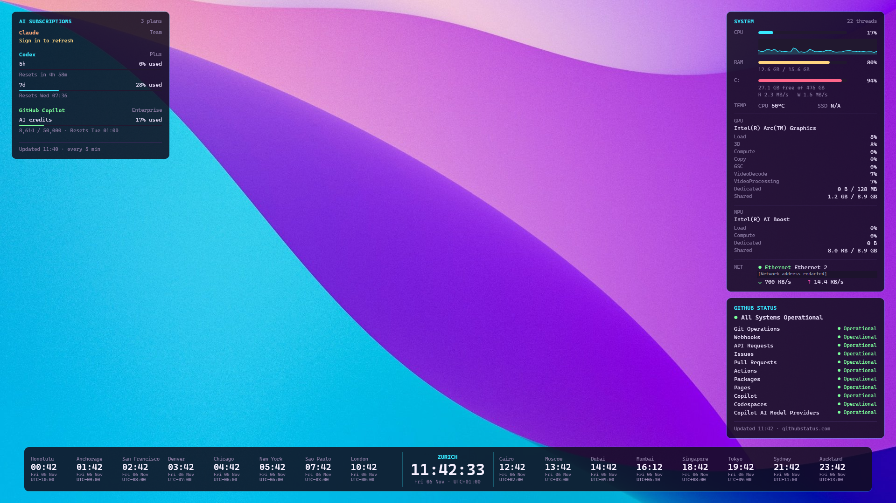

# DeskWeave

**Your desktop, tuned for AI-native engineering.**

AI subscription quotas. Machine health. Service status. World time. Native Windows widgets that keep your working context in view, without another dashboard tab.



*Actual secondary-screen capture at native 1920 x 1080. The network address line is redacted; all other readings, including the sign-in warning, are unchanged.*

## Less tab-switching. More context.

- **See your AI headroom.** Recognized paid Claude, Codex, GitHub Copilot and Antigravity plans, with available usage meters and reset times.
- **Know what your machine is doing.** CPU history, RAM, top processes by CPU/memory/GPU, system-drive space and I/O, network rates, and GPU/NPU telemetry where Windows exposes it.
- **Check service health before debugging your setup.** Public GitHub, Claude and OpenAI status, affected components, active incidents and scheduled maintenance.
- **Work across time zones.** Your local clock takes center stage, with eight cities on each side, UTC offsets and day-change markers.
- **Put a spare screen to work.** Choose primary, secondary or both. Borderless, click-through panels stay above the wallpaper and behind your apps.

Built with **.NET 10 + WPF**, styled with the Neon Intrusion palette, and inspired by [omarchy-setup](https://github.com/kasuken/omarchy-setup).

## Up and running

### Portable Windows download

Download the self-contained Windows x64 build from [GitHub Releases](https://github.com/kasuken/DeskWeave/releases/latest):

1. Download [DeskWeave-0.3.0-win-x64.zip](https://github.com/kasuken/DeskWeave/releases/download/v0.3.0/DeskWeave-0.3.0-win-x64.zip) and [SHA256SUMS.txt](https://github.com/kasuken/DeskWeave/releases/download/v0.3.0/SHA256SUMS.txt).
2. Compare `Get-FileHash .\DeskWeave-0.3.0-win-x64.zip -Algorithm SHA256` with the checksum file.
3. Extract the **entire** ZIP to a stable, writable folder, then run `DeskWeave.exe` inside its folder. Keep the bundled files together.

Requires a Windows 10/11 x64 desktop supported by .NET 10. The portable ZIP includes the runtime; no SDK or runtime installation and no administrator access are needed. Linux and macOS cannot run the WPF app. Provider CLIs and paid accounts are optional; the other widgets work without them.

> [!IMPORTANT]
> The build is unsigned. Windows SmartScreen or antivirus software may warn about an unrecognized app. Only win-x64 is validated; no ARM64 build is provided.

### Run from source

Install the [.NET 10 SDK](https://dotnet.microsoft.com/en-us/download/dotnet/10.0), then use PowerShell:

```powershell
git clone https://github.com/kasuken/DeskWeave.git
Set-Location .\DeskWeave
dotnet run --project .\src\DeskWeave\DeskWeave.csproj --configuration Release
```

The command restores dependencies, builds the app and starts its notification-area icon. No administrator access is required.

> [!TIP]
> No app window to open: look for **DeskWeave** in the notification area, including its hidden-icons menu. Only one instance runs at a time; exit an existing instance before launching a different build.

## Make it your desktop

Right-click the tray icon to select a screen:

| Tray option | Behavior |
| --- | --- |
| **Primary screen only** | Default. Widgets appear on the primary display. |
| **Secondary screen only** | Widgets appear on one non-primary display. Disabled when none is connected. |
| **Both screens** | A separately laid-out set on each display, sharing one set of sampling and polling loops. |

Screen selection survives restarts. Disconnecting the selected secondary temporarily moves its widgets to the primary; reconnecting restores the saved choice. With more than two monitors, DeskWeave uses the primary and the leftmost non-primary display, breaking ties by top edge, then device name.

Double-click the icon to show/hide widgets. The menu also provides **Show widgets**, **Refresh layout**, **Start with Windows** and **Exit**. Startup registration writes only a per-user Windows Run entry pointing to the current executable; keep that build in a stable location if you enable it.

Each screen uses its own DPI and work area. Layout updates when resolution, scaling, taskbar or connected displays change. Clocks wrap or stack on narrower screens; the system monitor and Top Processes scale together to keep their widths aligned above the clock, with Top Processes below the monitor when space allows. Service status may move beside the monitor, and panels hide when space is insufficient.

## Service status

The **Service status** tray menu enables or disables GitHub, Claude and OpenAI independently; all three are enabled initially. It also opens each provider's official status page. Selection persists across restarts and is independent of subscription sign-in. Disabled providers are not polled.

The panel shows provider-reported health, not a test of your account or connection. GitHub's feed supplies GitHub components, including **Copilot** and **Copilot AI Model Providers** where available. Claude's feed covers its public components, including Claude Code and the Claude API. OpenAI's component feed covers its reported API, ChatGPT and Codex components; names may be repeated because that feed does not include group labels. Active incidents and scheduled maintenance are distinct; long lists are summarized.

| Provider | Public, unauthenticated sources |
| --- | --- |
| GitHub | [Statuspage summary](https://www.githubstatus.com/api/v2/summary.json) |
| Claude | [Statuspage summary](https://status.claude.com/api/v2/summary.json) |
| OpenAI | [Status](https://status.openai.com/api/v2/status.json), [components](https://status.openai.com/api/v2/components.json), and [incident.io widget summary](https://status.openai.com/api/v1/summary) |

Each enabled provider is refreshed at most once per minute, honoring `Retry-After`; an OpenAI refresh consists of three requests. OpenAI's widget feed includes published ongoing incidents and maintenance, not unpublished updates; all three OpenAI feeds must succeed for a fresh reading. Provider failures are isolated. A last-known reading is marked offline and expires after 24 hours; with no recent data the provider is unavailable, not healthy. Unknown provider states are shown as unknown. Status pages and APIs can change or cease to be available.

## Connect your AI subscriptions

There is no separate DeskWeave account or API-key form. Sign in with the supported provider tools; DeskWeave reads their existing local credentials on each refresh.

| Provider | Sign-in source | Requests go to |
| --- | --- | --- |
| **Claude** | `~\.claude\.credentials.json`, or `.credentials.json` under `CLAUDE_CONFIG_DIR` | `api.anthropic.com/api/oauth/usage` |
| **Codex** | ChatGPT sign-in in `~\.codex\auth.json`, or `auth.json` under `CODEX_HOME`; API-key mode is not supported | `chatgpt.com/backend-api/wham/usage` |
| **GitHub Copilot** | GitHub CLI (`gh`) installed on `PATH` and signed into `github.com` | `gh api --hostname github.com /copilot_internal/user`; `gh` handles the token |
| **Antigravity** | Windows Credential Manager entry `gemini:antigravity`, falling back to `~\.gemini\antigravity-cli\antigravity-oauth-token`; `AGY_DIR` overrides that directory | `daily-cloudcode-pa.googleapis.com` |

Here, `~` means your Windows user-profile folder. These environment variables override credential directories, not individual file paths.

Quota refreshes run every **five minutes**. Missing credentials and free or unrecognized plans are omitted; no recognized plans means no quota panel. An available plan can still report **Quota unavailable** if its endpoint returns no supported limits.

Quota runway is an **estimate**, not a guarantee: it assumes the rate between the first and last recent observations continues until the limit resets. It uses at least three fresh observations spanning at least 15 minutes within the last hour, without making extra provider requests. Until enough data is available, or when recent usage is unchanged, it says so rather than predicting unlimited usage. A reset, counter decrease, plan/limit change, failed refresh or gap over 10 minutes starts a new series; stale readings do not advance it.

History does not contain account identifiers, so a switch between accounts with the same plan, limits and reset time may not be detected. To avoid mixing those accounts' observations, exit DeskWeave and delete `ai-quota-history.json` before reopening it after switching accounts.

If quota history cannot be read or saved, the tray menu shows a warning; quota refreshes continue.

> [!IMPORTANT]
> DeskWeave does not renew credentials. For **Sign in to refresh**, renew the sign-in using that provider's tool and wait for the next refresh. Provider usage APIs, including internal endpoints, can change independently of DeskWeave. This is a quota display, not a billing meter or agent-task tracker.

## Data, privacy and offline behavior

Machine metrics and clocks are calculated locally. **DeskWeave is not offline-only:** it contacts the enabled public status feeds described above and contacts the quota endpoints above when credentials are available.

Direct quota requests send bearer tokens only to the allowed provider HTTPS hosts; redirects are disabled. Those tokens are not logged or cached. For Copilot, DeskWeave invokes `gh` and reads its response rather than retrieving the GitHub token.

Local files live in `%LOCALAPPDATA%\DeskWeave`:

| File | Contents |
| --- | --- |
| `settings.json` | Saved monitor mode: `Primary`, `Secondary` or `Both`. Prefer changing it through the tray. |
| `service-status-settings.json` | Enabled public status providers. Prefer changing them through the tray. |
| `github-status.json` | Cached public service status. |
| `anthropic-status.json`, `openai-status.json` | Cached public Claude and OpenAI service status. |
| `ai-quota.json` | Display data: plan labels, usage limits, reset times and freshness/status metadata; no credentials. |
| `ai-quota-history.json` | Display-safe provider, plan, limit, reset time, observation time and usage percentages; capped at 1,024 observations and 512 KiB. History is pruned to the last 60 minutes when loaded or refreshed. No credentials or account identifiers. |

Status and quota caches retain last-known data for up to **24 hours**. Offline readings are explicitly marked and gray, not presented as fresh. Without recent data, status reports unavailable and quota providers can disappear.

> [!WARNING]
> The system panel displays your network name and IP address. Review screenshots before sharing them, and never publish provider credential files or raw authentication responses.

## Hardware and desktop limits

GPU/NPU readings depend on the Windows version, hardware and driver. No extra monitoring driver or vendor package is installed. Unsupported accelerator readings are **hidden**, not invented; an adapter with no meaningful live telemetry is hidden too.

<details>
<summary>What the hardware numbers mean</summary>

- Sampling runs every two seconds; adapter discovery refreshes every 30 seconds. DXCore identifies adapters, Windows performance counters supply load/memory, and read-only WDDM queries supply optional sensors.
- Overall utilization is the busiest physical engine, not the sum of overlapping engine percentages. New/reset counters can make a reading temporarily unknown.
- The separate Top Processes panel lists the top three processes independently by CPU, working-set memory and GPU, with color-coded rankings and comparison bars. Bars are relative to the leading process in each section, not overall resource capacity; the numbers show actual usage. Process CPU is normalized to total logical-processor capacity; GPU usage follows the busiest engine. Windows does not expose meaningful per-thread memory or GPU attribution.
- Dedicated and shared memory are separate. Shared capacity is a limit, not reserved VRAM; integrated-GPU dedicated capacity is not necessarily discrete VRAM.
- NPU identity does not guarantee usable utilization counters. Only explicitly identified NPUs receive that label; other compute-only devices are labeled Accelerator.
- Temperature, fan RPM and **relative power percentage** appear only when supported. Relative power is not watts. Sensor queries use physical node 0 on linked adapters.
- CPU temperature is the hottest available ACPI thermal zone, not necessarily the CPU package. SSD temperature is currently unimplemented and remains `N/A`; running as administrator does not enable it.

</details>

Widgets are read-only and click-through: no dragging, scrolling, tooltips or in-panel controls. **Win+D** can hide them; use the tray toggle to show them again. At most two displays are targeted.

The city catalog and colors currently live in source: [WorldClock.cs](src/DeskWeave.Core/WorldClock.cs) and [NeonIntrusion.xaml](src/DeskWeave/Theme/NeonIntrusion.xaml). There is no theme or city editor.

## Development

From the repository root on Windows:

```powershell
dotnet build .\DeskWeave.slnx --configuration Release
dotnet test .\DeskWeave.slnx --configuration Release --no-build
```

| Location | Responsibility |
| --- | --- |
| [`src/DeskWeave.Core`](src/DeskWeave.Core) | Platform-independent clocks, display selection, quota/status parsers, polling, caching and metric formatting. |
| [`src/DeskWeave`](src/DeskWeave) | WPF widgets, per-monitor layout, Windows telemetry/interop and tray lifecycle. |
| [`tests/DeskWeave.Core.Tests`](tests/DeskWeave.Core.Tests) | xUnit coverage for core behavior. |
| [`tests/DeskWeave.Tests`](tests/DeskWeave.Tests) | STA WPF coverage for clock layouts and integrated widget rendering. |

The tray is the interactive surface; `WidgetHost` owns shared data loops and `WidgetSet` owns each screen's windows. Keep provider parsing in Core and Windows-specific work in the WPF project.

To reproduce the portable build from the [v0.3.0 source](https://github.com/kasuken/DeskWeave/tree/v0.3.0), use .NET SDK 10.0.404 on Windows x64:

```powershell
dotnet publish .\src\DeskWeave\DeskWeave.csproj --configuration Release --runtime win-x64 --self-contained true -p:PublishSingleFile=false -p:PublishTrimmed=false -p:DebugType=None -p:DebugSymbols=false --output .\artifacts\DeskWeave-0.3.0-win-x64
Compress-Archive -Path .\artifacts\DeskWeave-0.3.0-win-x64 -DestinationPath .\artifacts\DeskWeave-0.3.0-win-x64.zip
```

`--self-contained true` includes the .NET runtime in the publish folder. Package the entire folder in the release ZIP, not just `DeskWeave.exe`.

See the [changelog](CHANGELOG.md) for user-facing changes. No project license has been selected; public availability does not grant an open-source license.
